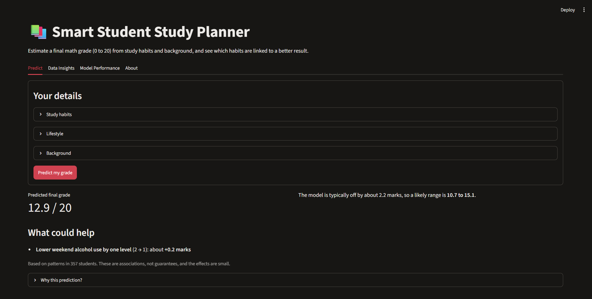
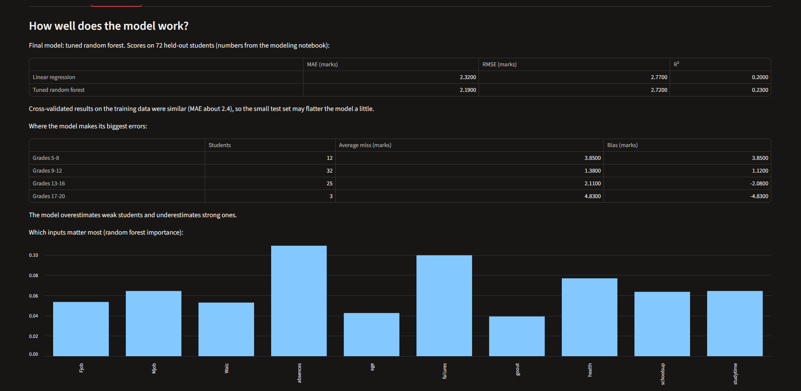

# Smart Student Study Planner

A machine learning app that estimates a student's final math grade from study habits and background, and shows which habits are linked to a better result.

## Demo




Run it locally with `streamlit run app.py` (see [How to run locally](#how-to-run-locally)).

## Problem statement and impact

Students often do not know how much their daily habits, such as study time, absences and past failures, are linked to their final result. This project predicts the final math grade (G3, 0 to 20) from information available early in the term, and for each student tests a few habit changes to see which are linked to a higher predicted grade.

**Who benefits:** a school student planning their study time, or a teacher or counsellor supporting them.

**Decision supported:** where to put effort (for example, more study time or fewer absences) before exams.

## Dataset

- **Source:** [UCI Student Performance dataset](https://archive.ics.uci.edu/dataset/320/student+performance), math course (`student-mat.csv`).
- **Size:** 395 students and 33 columns (demographics, family background, study habits, lifestyle, absences and three period grades).
- **Target:** `G3`, the final grade (0 to 20). This is a **regression** problem.
- **Features used:** 30 columns. The earlier grades `G1` and `G2` are excluded (see below).
- **Cleaning:** 38 students with `G3 = 0` were removed, leaving **357 students**.

## Approach

1. **EDA** (`notebooks/01_eda.ipynb`): checked data quality, explored every feature against the target, and wrote an insight under each chart.
2. **Excluding G1 and G2:** these are earlier grades from the same course. They correlate very strongly with G3 (G2 around 0.97), but a student planning early in the term would not have them, so using them would leak the answer.
3. **Removing zero grades:** all 38 students with `G3 = 0` also had exactly 0 absences. This suggests they dropped out or did not sit the exam, so their zero means "no result" and not "a low score". The planner is meant for students who take the exam.
4. **Preprocessing** (`notebooks/02_modeling.ipynb`): 80/20 train/test split (285 and 72 students, fixed seed) done before any fitting. One-hot encoding for categorical columns and standard scaling for numeric ones, fitted on the training data only (30 inputs become 43 columns).
5. **Modeling:** a linear regression baseline, then a decision tree, a random forest and a gradient boosting model, all compared with 5-fold cross-validation on the training data, inside a scikit-learn `Pipeline` so preprocessing is re-fitted in every fold.
6. **Tuning:** `RandomizedSearchCV` (20 combinations) on the random forest, scored by MAE.
7. **Evaluation:** the final model was scored once on the held-out test set.
8. **Interpretation and error analysis:** permutation importance and a study of where the model fails.
9. **App** (`app.py`): the saved pipeline is loaded by a Streamlit app with Predict, Data Insights, Model Performance and About tabs. The "What could help" suggestions re-run the model with one habit changed at a time (study time, absences, going out, weekend alcohol use).

## Results

Primary metric: **MAE** (mean absolute error), because it reads directly in marks. RMSE and R² are supporting metrics.

**5-fold cross-validation on the training data (285 students)**

| Model | MAE | RMSE | R² |
|---|---|---|---|
| Linear regression (baseline) | 2.44 | 3.07 | 0.09 |
| Decision tree (max depth 4) | 2.84 | 3.50 | -0.18 |
| Random forest (200 trees) | 2.44 | 3.02 | 0.12 |
| [BOOSTER NAME] | [MAE] | [RMSE] | [R²] |
| Random forest, tuned | 2.43 | | |

**Held-out test set (72 students)**

| Model | MAE | RMSE | R² |
|---|---|---|---|
| Linear regression | 2.32 | 2.77 | 0.20 |
| Tuned random forest (final model) | 2.19 | 2.72 | 0.23 |

The final model's tuned settings: 100 trees, maximum depth 8, at least 5 students per leaf, all features considered at each split.

## Key insights

- **Past failures** show the clearest link to the final grade: the average falls from about 11.9 with no failures to about 8.3 with three.
- **Absences** only show a link to the grade after the zero-grade rows are removed (correlation about -0.21).
- **Parents' education** and **going out** are also linked to the grade (higher parental education, higher grades; more going out, lower grades).
- **School support** is linked to *lower* grades, probably because support goes to students who are already struggling, so it should not be read as a cause.
- **Extra paid classes** show almost no difference.
- The models all perform similarly (MAE about 2.4 marks in cross-validation). Without G1 and G2, the remaining features carry limited signal, so tuning and more complex models help only slightly.
- **Error analysis:** the model is most accurate for mid-range grades (9 to 12) and least accurate at the extremes. It overestimates weak students (average error +3.85 marks for grades 5 to 8) and underestimates strong ones. This is regression to the mean: with weak features, predictions cluster near the average.

## Challenges faced

- **Data format:** the CSV uses semicolons, so a default `read_csv` returned one giant column. Fixed with `sep=";"`.
- **Zero grades:** the zeros looked like a normal part of the distribution until I found that all of them had 0 absences. I treated them as a separate group (dropouts or no-shows) and removed them, documenting the reason.
- **Data leakage:** G1 and G2 gave a very high score but made the planner pointless. Excluding them lowered the score but made the model honest.
- **Small test set:** test scores (MAE 2.19, R² 0.23) came out better than cross-validation (MAE about 2.43, R² about 0.1). With only 72 test students, I treat the cross-validation results as the more reliable estimate.
- **Misleading advice risk:** some features should not become advice. Past failures cannot be changed, and school support is linked to lower grades only because of who receives it, so the suggestions use only a few habits with a plausible story.

## How to run locally

```bash
git clone https://github.com/dhanushhh13/smart-student-study-planner.git
cd smart-student-study-planner
python -m venv .venv
.venv\Scripts\activate          # Windows (on macOS/Linux: source .venv/bin/activate)
pip install -r requirements.txt
streamlit run app.py
```

To reproduce the analysis, run `notebooks/01_eda.ipynb` and then `notebooks/02_modeling.ipynb` (this saves the model to `models/`).

## Limitations and future improvements

**Limitations**
- Small dataset (357 students after cleaning), from two Portuguese schools, mostly self-reported. Results may not transfer to other schools or regions.
- The model estimates grades for students who sit the exam. It cannot predict dropout.
- Absences in the data cover the whole period, but a student planning early in the term would only have a partial count.
- Suggestions show associations, not causes, and the predicted gains are small (typically 0.1 to 1 mark).
- Predictions are less reliable for very low and very high grades, and the test set is small.

**Future improvements**
- Add the Portuguese-course file from the same source to double the data, and collect local data.
- Add a separate model for students at risk of dropping out (classification).
- Try a version that uses G1 as an extra input, for mid-term planning.
- Explain individual predictions with SHAP, and deploy on Streamlit Community Cloud.

## Repository structure

```
smart-student-study-planner/
|-- README.md
|-- PROBLEM_STATEMENT.md
|-- requirements.txt
|-- app.py
|-- data/          student-mat.csv
|-- notebooks/     01_eda.ipynb, 02_modeling.ipynb
|-- src/           recommend.py
|-- models/        saved pipeline and feature list
|-- images/        screenshots
```

## Tech stack and contact

Python, pandas, NumPy, scikit-learn, Matplotlib, Seaborn, Streamlit, joblib.

**Dhanush** | GitHub: [dhanushhh13](https://github.com/dhanushhh13) | LinkedIn: [https://www.linkedin.com/in/dhanushhh13] | Email: [dhanushhhs13@gmail.com]
